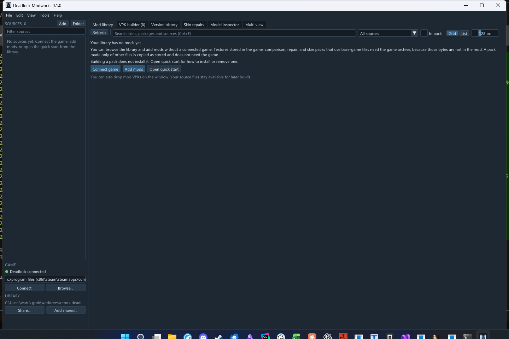

# Deadlock Modworks

Deadlock Modworks 0.1.0 is a Windows app for a local collection of Deadlock mods. It browses skins, inspects and compares models, repairs supported skeleton changes, keeps a version history, shares that library, and assembles selected models into one VPK. Assembly does not install the pack, and it does not cover every kind of mod.

It also downloads Deadlock mods from GameBanana (**Get mods**, **Ctrl+8**) and turns library mods on or off in the game (**Mods**, **Ctrl+7**): you tick mods, set their load order and profiles, and **Apply to game** places them in `game\citadel\addons`. Modworks only changes the files it placed there. See [Mods](docs/USER_GUIDE.md#mods) and [Get mods](docs/USER_GUIDE.md#get-mods).

The program is `DeadlockModworks.exe`. The release artifact is `DeadlockModworks-0.1.0-win-x64.zip`. `v0.1.0` is not tagged, and a GitHub release has not been published. Publishing that zip is still a draft step. Until a maintainer publishes it, use a zip built with the steps in [Releasing](docs/RELEASING.md), or build from source. `scripts/Publish.ps1` was not run for this documentation update, so this commit did not produce a zip.

That picture is `docs/screenshots/startup-empty-library.png`, a capture of the real window. The library is empty and shows **Connect game**, **Add mods**, and **Open quick start**. The capture includes desktop around the window. A side-by-side comparison of two models was not captured. The **Quick start** popup was not opened for this picture.

## What you need

- 64-bit Windows.
- A graphics driver that supports Vulkan 1.3. `vulkan-1.dll` comes from that driver and is delay-loaded. It is not in the zip. A missing loader is supposed to show a message instead of failing in the static imports. That dialog was not observed.
- No Visual Studio, Vulkan SDK, installer, or administrator account for normal use. The executable is linked with the static MSVC runtime, so the zip does not include `VCRUNTIME` or `MSVCP` DLLs.

You can browse the library and add mods without a connected game. Textures stored in the game, comparison, repair, and skin packs that use base-game files need the game archive. A pack made only of other files is copied as stored and does not need the game.

There is no installer, automatic update, code signing, or GameBanana account sign-in. Downloading from GameBanana needs an internet connection. A clean-machine launch and code signing were not run.

## First run

1. Extract `DeadlockModworks-0.1.0-win-x64.zip`. No installer or administrator prompt is required.
2. Double-click `DeadlockModworks.exe`. A normal start does not need a terminal or a build tool.
3. If the library is empty, the page says **Your library has no mods yet.** It says browsing and adding mods work without the game, and that building a pack does not install it. The buttons are **Connect game**, **Add mods**, and **Open quick start**. **Help > Quick start** opens a modal titled **Quick start**. That popup was not clicked. Its eight steps are in the [quick start](docs/QUICK_START.md).
4. Steam fills the game archive when none is saved. The status bar says **Deadlock connected** when that succeeds. You can still type `game\citadel` or `pak01_dir.vpk` and choose **Connect**, or use **Browse...** or **File > Choose game archive...** (**Ctrl+G**).
5. Choose **Add mods** or **File > Add mods...** (**Ctrl+O**) and select mod `.vpk` files. The empty page also says you can drop mod VPKs on the window. A drop was not performed.
6. Double-click a skin to inspect it. Tick its checkbox, or press **Space**, to include it. Open the **VPK builder** tab and choose **Build VPK...** (**Ctrl+B**).
7. After a pack is assembled, a modal titled **Pack assembled** shows the summary. A library build says `Exported N file to <path>.` or `Exported N files to <path>.` **Assemble...** on **Version history** says `Assembled a pack at <path>.` The modal then says assembly writes a VPK, does not install the pack, and does not guarantee compatibility. The buttons are **Reveal in Explorer**, **Open quick start**, and **Close**. No pack was built for this update, so that modal was not shown.
8. Close Deadlock and copy the file into `game\citadel\addons` yourself. Do not replace `pak01_dir.vpk` or the game's chunk files. Delete that copy from `addons` to take the pack out. Modworks does not copy a built pack in or out.

To use mods without building a pack, open **Get mods** (**Ctrl+8**), paste a GameBanana link or search, and choose **Download & enable**. Then open **Mods** (**Ctrl+7**), close Deadlock, and choose **Apply to game**. Untick a mod and apply again to take it out. To install your own pack the same way, choose **Build as mod...** instead of **Build VPK...** and give it a name; building again under that name replaces it.

The same steps, with the failure cases, are in the [quick start](docs/QUICK_START.md). The zip from `Publish.ps1` contains this README, not the `docs` folder. The longer guides are in the source repository.

The collection is stored in `%LOCALAPPDATA%\DeadlockModManager`. `--data-root <directory>` overrides that, and otherwise the environment variable `DEADLOCK_MODWORKS_DATA_ROOT` does. The flag wins when both are set.

Errors are appended to `<data-root>\logs\modworks.log`. With the default root that file is `%LOCALAPPDATA%\DeadlockModManager\logs\modworks.log`. A start with no error does not create it. **Help > Open logs** selects that file in Explorer when it exists. If it does not, the status line says `No log file yet. Errors are written to <path>.` **Help > Copy diagnostic details** copies the product title, the build commit, the data root, and the waiting error, or **No error is waiting.** Those two menu items were not clicked.

Saved preferences are `<data-root>\store\settings.json`. A corrupt `settings.json` is left as it is, the catalog is left in place, and an error is shown. A read-only `store\catalog.sqlite` is not replaced.

## Guides

- [Quick start](docs/QUICK_START.md) — extract, launch, connect, import, inspect, select, build, then install or remove.
- [User guide](docs/USER_GUIDE.md) — the workspace, shortcuts, comparison, repairs, history, sharing, and backups.
- [Troubleshooting](docs/TROUBLESHOOTING.md) — graphics, missing game files, bad mods, export conflicts, and storage.
- [Building](docs/BUILDING.md) — compile from source.
- [Releasing](docs/RELEASING.md) — how a maintainer builds the zip. The tag workflow has not been run.
- [Changelog](CHANGELOG.md)
- [Third-party notices](THIRD_PARTY_NOTICES.md)
- [License](LICENSE) — MIT, `Copyright (c) 2026 CyN1ckal`.

**Help > About** shows the product title and the build commit. `DeadlockModworks.exe --version` prints the same identity. **Help > Keyboard shortcuts** (**F1**) lists the shortcuts. **Help** also has **Quick start**, **Open logs**, and **Copy diagnostic details**.
