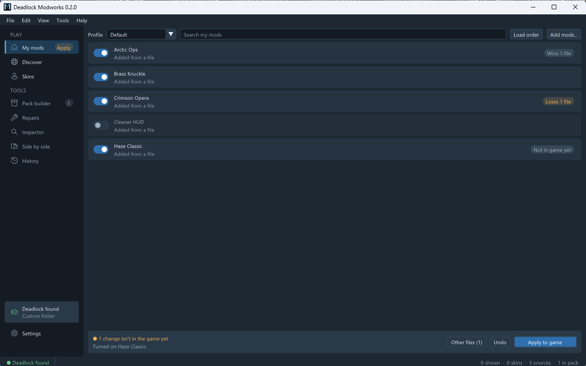
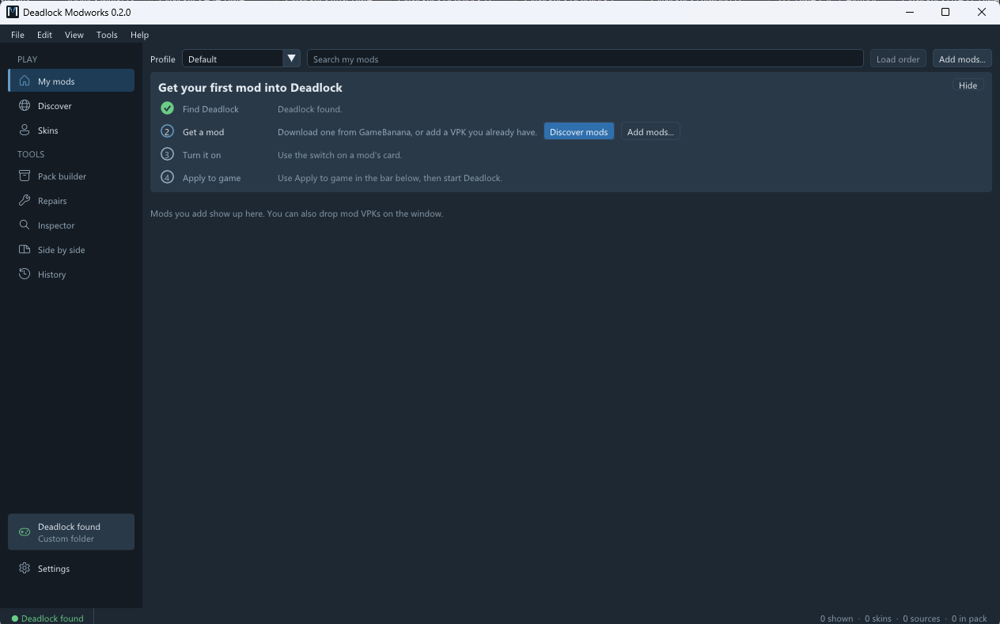
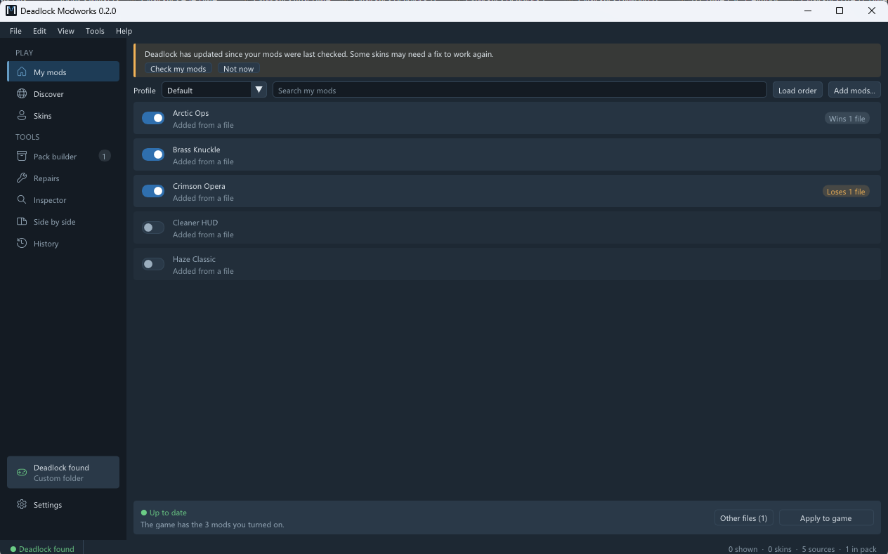

# Deadlock Modworks

A Windows mod manager for Deadlock. Find mods on GameBanana, turn them on with a switch, and put them in the game with one button. When Deadlock updates and breaks a skin, Modworks can often fix it.

**[Download the latest release](https://github.com/CyN1ckal/Deadlock-Modworks/releases/latest)** · version 0.2.0 · `DeadlockModworks-0.2.0-win-x64.zip`

## What it does

- **My mods.** Every mod you have is a card with an on/off switch. Badges show where two mods change the same file and which one wins. **Load order** decides that, and **profiles** keep separate sets, for example one for ranked.
- **Apply to game.** The bar under the list says what isn't in the game yet. Close Deadlock, choose **Apply to game**, and start it again. Turn a mod off and apply again to take it out. Modworks only touches the files it placed in `game\citadel\addons`.
- **Discover.** Browse, search and sort Deadlock mods on GameBanana, or paste a mod link, then **Download & enable**.
- **After a game update.** Modworks notices when Deadlock has updated and offers **Check my mods**, then **Fix n mods** for the skins it can repair. Each fix is saved as a new version, and the original is kept.
- **Tools for modders.** Under **TOOLS**, the original workspace is still there: a skin browser, a 3D model inspector, side-by-side comparison, skeleton repairs, a version history, and a **Pack builder** that combines skins from several mods into one. **Add to My mods...** installs that pack like any other mod. **Build VPK file...** writes a `.vpk` instead.

## Getting started

1. Download `DeadlockModworks-0.2.0-win-x64.zip` from [Releases](https://github.com/CyN1ckal/Deadlock-Modworks/releases/latest) and extract it anywhere. There is no installer and no administrator prompt.
2. Run `DeadlockModworks.exe`. It finds a Steam install of Deadlock by itself. If it doesn't, use **File > Locate Deadlock...** and choose `game\citadel`.
3. A checklist on **My mods** walks you through the rest: get a mod, turn it on, apply to game.

To add mods you already have, choose **Add mods...** (**Ctrl+O**) or drop `.vpk` files on the window.

When Deadlock updates, a banner on **My mods** offers to check your mods:

The [quick start](docs/QUICK_START.md) has the same steps, plus what to do when one fails.

## What you need

- 64-bit Windows.
- A graphics driver with Vulkan 1.3. Any recent NVIDIA, AMD or Intel driver has it.
- An internet connection for **Discover**. No GameBanana account is needed.

You don't need Deadlock connected to browse or add mods. Textures stored in the game, comparisons, repairs and skin packs that use base-game files do need it.

The executable isn't code-signed, so Windows SmartScreen may warn the first time you run it. There is no auto-update yet; new versions are posted on [Releases](https://github.com/CyN1ckal/Deadlock-Modworks/releases).

## Where your data lives

- Your library is stored in `%LOCALAPPDATA%\DeadlockModManager`. To use another folder, pass `--data-root <folder>` or set `DEADLOCK_MODWORKS_DATA_ROOT`. The flag wins when both are set.
- Enabled mods, load order and profiles are in `mods.json` there. Preferences are in `store\settings.json`.
- Errors go to `logs\modworks.log` in the same folder. **Help > Open logs** shows the file, and **Help > Copy diagnostic details** copies the version, build and data folder for a bug report.

## Guides

- [Quick start](docs/QUICK_START.md): from extracting the zip to a mod in the game.
- [User guide](docs/USER_GUIDE.md): every page, shortcuts, repairs, history, sharing and backups.
- [Troubleshooting](docs/TROUBLESHOOTING.md): graphics, missing game files, bad mods and build conflicts.
- [Building](docs/BUILDING.md): compile from source.
- [Releasing](docs/RELEASING.md): how a maintainer packages and publishes the zip.
- [Changelog](CHANGELOG.md)
- [Third-party notices](THIRD_PARTY_NOTICES.md)
- [License](LICENSE): MIT, `Copyright (c) 2026 CyN1ckal`.

**Help > About** and `DeadlockModworks.exe --version` show the version and build commit. **F1** lists the keyboard shortcuts.
