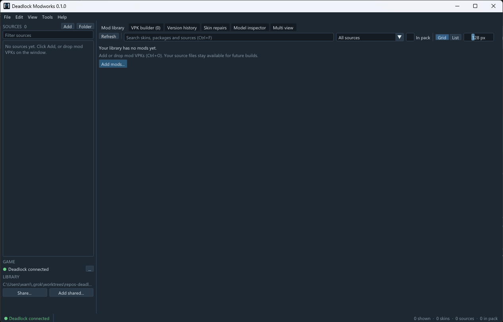

# Deadlock Modworks

Deadlock Modworks 0.1.0 is a Windows app for a local collection of Deadlock mods. It browses skins, inspects and compares models, repairs supported skeleton changes, keeps a version history, shares that library, and assembles selected models into one VPK. Assembly does not install the pack, and it does not cover every kind of mod.

The program is `DeadlockModworks.exe`. The release artifact is `DeadlockModworks-0.1.0-win-x64.zip`. `v0.1.0` is not tagged, and a GitHub release has not been published. Publishing that zip is still a draft step. Until a maintainer publishes it, use a zip built with the steps in [Releasing](docs/RELEASING.md), or build from source.

That picture is a capture of the real window, cropped to the window. The library in the capture was empty. Other captures of the same session are in `docs/screenshots/`. A side-by-side comparison of two models was not captured.

## What you need

- 64-bit Windows.
- A graphics driver that supports Vulkan 1.3. `vulkan-1.dll` comes from that driver. It is not in the zip.
- No Visual Studio, Vulkan SDK, installer, or administrator account for normal use. The executable is linked with the static MSVC runtime, so the zip does not include `VCRUNTIME` or `MSVCP` DLLs.

Connecting Deadlock is required for game textures, comparison with the game, skeleton repair, and packing files that only the game supplies. You can still open a library that is already stored when the game is not connected.

There is no installer, automatic update, code signing, mod marketplace, or one-click install into the game.

## First run

1. Extract `DeadlockModworks-0.1.0-win-x64.zip`.
2. Double-click `DeadlockModworks.exe`.
3. If the status bar does not say **Deadlock connected**, choose **File > Choose game archive...** (**Ctrl+G**) and select `game\citadel\pak01_dir.vpk` inside the Deadlock install.
4. Choose **File > Add mods...** (**Ctrl+O**) and select mod `.vpk` files. You can also drop them on the window.
5. Double-click a skin to inspect it. Tick its checkbox, or press **Space**, to include it. Open the **VPK builder** tab and choose **Build VPK...** (**Ctrl+B**). The status line names the `.vpk` it wrote.
6. Close Deadlock and copy that file into `game\citadel\addons`. Do not replace `pak01_dir.vpk` or the game's chunk files. Delete that copy from `addons` to take the pack out. Modworks does not copy it in or out.

The same steps, with the failure cases, are in the [quick start](docs/QUICK_START.md). The zip from `Publish.ps1` contains this README, not the `docs` folder. The longer guides are in the source repository.

The collection is stored in `%LOCALAPPDATA%\DeadlockModManager`. `--data-root <directory>` overrides that, and otherwise the environment variable `DEADLOCK_MODWORKS_DATA_ROOT` does. The flag wins when both are set.

## Guides

- [Quick start](docs/QUICK_START.md) — extract, connect, import, inspect, build, install, and recover.
- [User guide](docs/USER_GUIDE.md) — the workspace, shortcuts, comparison, repairs, history, sharing, and backups.
- [Troubleshooting](docs/TROUBLESHOOTING.md) — graphics, missing game files, bad mods, export conflicts, and storage.
- [Building](docs/BUILDING.md) — compile from source.
- [Releasing](docs/RELEASING.md) — how a maintainer builds the zip. The tag workflow has not been run.
- [Changelog](CHANGELOG.md)
- [Third-party notices](THIRD_PARTY_NOTICES.md)
- [License](LICENSE) — MIT.

**Help > About** shows the product title and the build commit. `DeadlockModworks.exe --version` prints the same identity. **Help > Keyboard shortcuts** (**F1**) lists the shortcuts.
